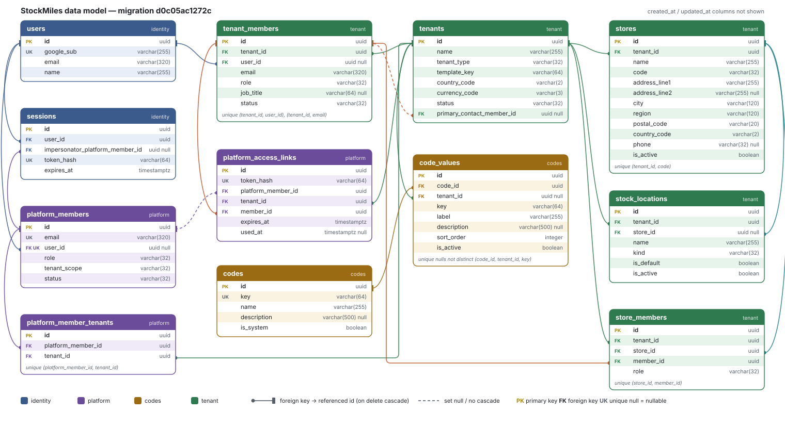
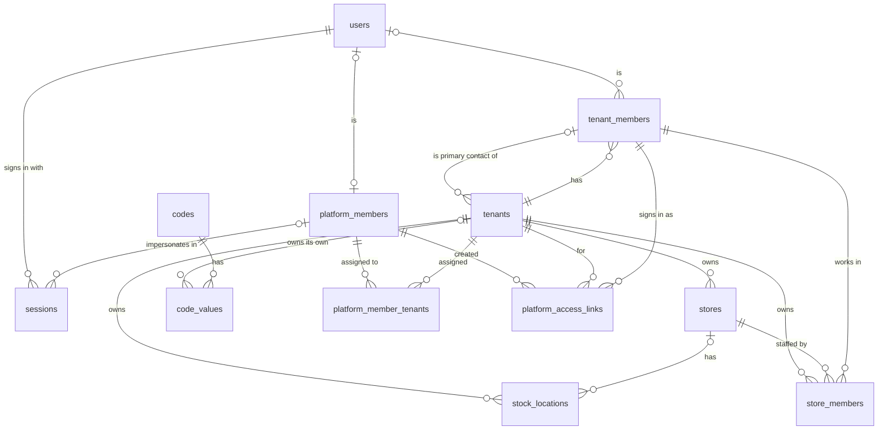

# StockMiles data model

Schema at migration `d0c05ac1272c` (the database has 12 tables plus `alembic_version`). The models in `app/models/` are the source; update this page whenever a migration changes the schema.

The picture above shows every column; the diagram below shows relationships only.

## Relationships

How to read the line ends: `||` exactly one, `|o` zero or one, `o{` zero or many.

## Areas

| Area | Tables | Kind |
|---|---|---|
| Identity | `users`, `sessions` | Global |
| Platform | `platform_members`, `platform_member_tenants`, `platform_access_links` | Global |
| Codes | `codes`, `code_values` | Global (system rows, `tenant_id` NULL) and tenant-owned (rows with a `tenant_id`) |
| Tenant | `tenants`, `tenant_members`, `stores`, `stock_locations`, `store_members` | Tenant-owned |

Every tenant-owned table carries `tenant_id` directly, so one tenant's rows can be found without joins ([constitution.md](../../constitution.md), Article 1).

## Tables

All `id` columns are UUID primary keys generated by the application. `created_at` and `updated_at` default to `now()` in the database and are left out of the column lists below.

### users

| Column | Type | Null | Notes |
|---|---|---|---|
| `google_sub` | varchar(255) | no | Unique. Google's stable account id |
| `email` | varchar(320) | no | |
| `name` | varchar(255) | no | |

### sessions

| Column | Type | Null | Notes |
|---|---|---|---|
| `user_id` | uuid | no | → `users`, cascade |
| `impersonator_platform_member_id` | uuid | yes | → `platform_members`, cascade. Set only on a session opened through a member access link |
| `token_hash` | varchar(64) | no | Unique. SHA-256 of the cookie token; the token itself is never stored |
| `expires_at` | timestamptz | no | |

No `updated_at`.

### tenants

| Column | Type | Null | Notes |
|---|---|---|---|
| `name` | varchar(255) | no | Not unique |
| `tenant_type` | varchar(32) | no | Code `tenant_type`: `individual`, `chain`, `franchise` |
| `template_key` | varchar(64) | no | Industry template chosen at onboarding |
| `country_code` | varchar(2) | no | ISO 3166-1 alpha-2 |
| `currency_code` | varchar(3) | no | ISO 4217 |
| `status` | varchar(32) | no | Default `draft`. Code `tenant_status`: `draft`, `active`, `suspended` |
| `primary_contact_member_id` | uuid | yes | → `tenant_members`, set null on delete |

### tenant_members

| Column | Type | Null | Notes |
|---|---|---|---|
| `tenant_id` | uuid | no | → `tenants`, cascade |
| `user_id` | uuid | yes | → `users`, cascade. Empty until an invited person first signs in |
| `email` | varchar(320) | no | |
| `role` | varchar(32) | no | Code `tenant_role`: `owner`, `admin`, `accountant`, `staff` |
| `job_title` | varchar(64) | yes | Free label, never checked by the program |
| `status` | varchar(32) | no | No default. Code `member_status`: `invited`, `active`, `disabled` |

Unique: (`tenant_id`, `user_id`), (`tenant_id`, `email`).

### stores

| Column | Type | Null | Notes |
|---|---|---|---|
| `tenant_id` | uuid | no | → `tenants`, cascade |
| `name` | varchar(255) | no | |
| `code` | varchar(32) | no | Short store code |
| `address_line1` | varchar(255) | no | |
| `address_line2` | varchar(255) | yes | |
| `city` | varchar(120) | no | |
| `region` | varchar(120) | no | State or province |
| `postal_code` | varchar(20) | no | |
| `country_code` | varchar(2) | no | ISO 3166-1 alpha-2 |
| `phone` | varchar(32) | yes | |
| `is_active` | boolean | no | Default true |

Unique: (`tenant_id`, `code`).

### stock_locations

| Column | Type | Null | Notes |
|---|---|---|---|
| `tenant_id` | uuid | no | → `tenants`, cascade |
| `store_id` | uuid | yes | → `stores`, cascade. Empty for a tenant-level warehouse |
| `name` | varchar(255) | no | |
| `kind` | varchar(32) | no | Code `location_kind`: `sales_floor`, `stock_room`, `warehouse` |
| `is_default` | boolean | no | Default false. The location created with a store |
| `is_active` | boolean | no | Default true |

### store_members

| Column | Type | Null | Notes |
|---|---|---|---|
| `tenant_id` | uuid | no | → `tenants`, cascade |
| `store_id` | uuid | no | → `stores`, cascade |
| `member_id` | uuid | no | → `tenant_members`, cascade |
| `role` | varchar(32) | no | Code `store_role`: `manager`, `sales` |

Unique: (`store_id`, `member_id`).

### codes

| Column | Type | Null | Notes |
|---|---|---|---|
| `key` | varchar(64) | no | Unique, for example `tenant_type` |
| `name` | varchar(255) | no | |
| `description` | varchar(500) | yes | |
| `is_system` | boolean | no | Default false. True when `app/core/enums.py` has a matching enum and the program branches on the values |

### code_values

| Column | Type | Null | Notes |
|---|---|---|---|
| `code_id` | uuid | no | → `codes`, cascade |
| `tenant_id` | uuid | yes | → `tenants`, cascade. Empty for values shared by every tenant |
| `key` | varchar(64) | no | Stored in business tables, for example `individual` |
| `label` | varchar(255) | no | Shown in the UI |
| `description` | varchar(500) | yes | |
| `sort_order` | integer | no | Default 0 |
| `is_active` | boolean | no | Default true. Inactive values are shown as "Soon" |

Unique: (`code_id`, `tenant_id`, `key`) with `NULLS NOT DISTINCT`, so a shared value cannot be inserted twice.

Seeded system codes: `tenant_type`, `tenant_status`, `tenant_role`, `store_role`, `member_status`, `location_kind`, `platform_role`, `platform_tenant_scope` (8 codes, 21 values).

### platform_members

| Column | Type | Null | Notes |
|---|---|---|---|
| `email` | varchar(320) | no | Unique. Comes from the seed file |
| `user_id` | uuid | yes | Unique. → `users`, cascade. Filled at first sign-in |
| `role` | varchar(32) | no | Code `platform_role`: `platform_admin` |
| `tenant_scope` | varchar(32) | no | Code `platform_tenant_scope`: `all`, `assigned` |
| `status` | varchar(32) | no | Code `member_status` |

### platform_member_tenants

| Column | Type | Null | Notes |
|---|---|---|---|
| `platform_member_id` | uuid | no | → `platform_members`, cascade |
| `tenant_id` | uuid | no | → `tenants`, cascade |

Unique: (`platform_member_id`, `tenant_id`). Used only when `tenant_scope` is `assigned`. No `updated_at`.

### platform_access_links

| Column | Type | Null | Notes |
|---|---|---|---|
| `token_hash` | varchar(64) | no | Unique. The link token itself is never stored |
| `platform_member_id` | uuid | no | → `platform_members`, no cascade, so audit rows keep their author |
| `tenant_id` | uuid | no | → `tenants`, cascade |
| `member_id` | uuid | no | → `tenant_members`, cascade |
| `expires_at` | timestamptz | no | |
| `used_at` | timestamptz | yes | Set when the link is redeemed; a link works once |

No `updated_at`. Rows are kept as the audit log of member access links.

## Delete behaviour

- Deleting a tenant removes its members, stores, stock locations, store members, own code values, platform assignments and access links.
- Deleting a store removes its stock locations and store members.
- Deleting a tenant member removes their store memberships and access links, and clears `tenants.primary_contact_member_id` if it pointed at them.
- A platform member who created access links cannot be deleted; disable them instead.
